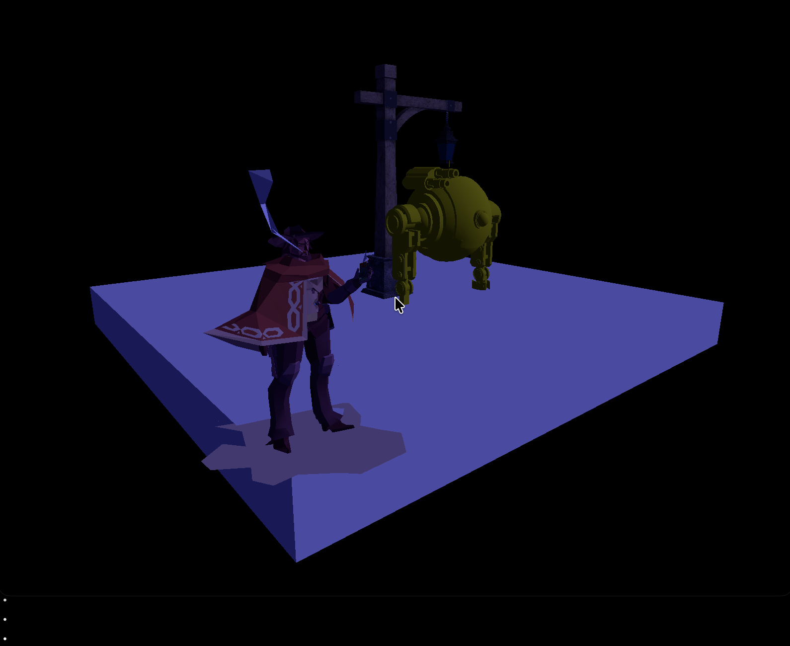

Experimenting with WGPU for realtime rendering.

Most of the code if in the `/modules` diretory:
`Engine` - wraps everything else into a unified API
`WGPU` - WGPU bindingr for Jai
`Renderer` - The render, uses instancing/batched draw calls as much as I can for efficiency. Has Blinn-Phong-like shading, but no shadows, etc.
`GLTF` - my own GLTF parser written from scratch for Jai (uses Jaison for JSON parsing tho)
`GLFW` - GLTF bindings for Jai
`Window` - Wrapper around GLFW so it can be replaced.

Not much of interest here, actually. This is rather a project to interact with WGPU and make it work with Jai.

Here's a simple scene made using free models:

